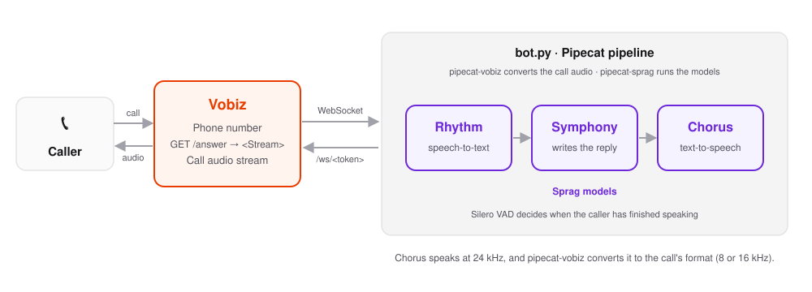

# Vobiz Sprag Pipecat

A phone voice agent that answers calls on a [Vobiz](https://www.vobiz.ai) number with [Sprag](https://sprag.ai/)'s speech and language models, built with [Pipecat](https://github.com/pipecat-ai/pipecat).

- **Rhythm** (Sprag) turns the caller's speech into text.
- **Symphony** (Sprag's own model) writes the reply.
- **Chorus** (Sprag) speaks it on the call.

Full guide: [Sprag with Pipecat on Vobiz](https://www.vobiz.ai/docs/integrations/sprag-pipecat).

## Architecture

<picture>
  <source media="(prefers-color-scheme: dark)" srcset="docs/architecture-dark.svg">
  
</picture>

[`pipecat-vobiz`](https://pypi.org/project/pipecat-vobiz/) converts between Vobiz's stream format and Pipecat audio, and [`pipecat-sprag`](https://pypi.org/project/pipecat-sprag/) provides the Sprag services. Chorus speaks at 24 kHz, and `pipecat-vobiz` converts it to the call's format.

## Quick start

You need Python 3.11 or later, a Sprag API key, and a Vobiz account with a phone number.

```bash
git clone https://github.com/vobiz-ai/Vobiz-Sprag-Pipecat.git
cd Vobiz-Sprag-Pipecat
python -m venv .venv && source .venv/bin/activate
pip install -r requirements.txt
cp .env.example .env   # then fill in your keys
python bot.py
```

The server listens on port `8765`.

## Test it without a phone

`simulate_call.py` plays the part of Vobiz: it opens the same stream Vobiz would, asks one question, and saves the agent's greeting and reply as WAV files. It needs [ffmpeg](https://ffmpeg.org/download.html).

```bash
# In a second terminal, with bot.py running
python simulate_call.py                                       # mu-law at 8000 Hz, the phone default
python simulate_call.py --encoding audio/x-l16 --rate 16000   # wideband
python simulate_call.py --wav my-question.wav                 # your own recording
```

On macOS, the caller's question is spoken with `say`. On other systems, pass a recording with `--wav`.

## Inbound calls

1. Give the server a public HTTPS URL, for example with a tunnel: `ngrok http 8765`.
2. [Create a voice application](https://www.vobiz.ai/docs/applications/create-application) with the **Answer URL** `https://<your-host>/answer`.
3. [Attach your number](https://www.vobiz.ai/docs/applications/attach-number) to the application.
4. Call the number. The agent greets you and answers your questions.

## Outbound calls

[Make a call](https://www.vobiz.ai/docs/call/make-call) with `answer_url` set to `https://<your-host>/answer`. When the person answers, the agent starts talking.

Calls are billed to your Vobiz account, and Sprag usage to your Sprag account. Test with your own number first.

## Endpoints

| Path | Method | Purpose |
| --- | --- | --- |
| `/answer` | GET, POST | Returns the XML that streams the call to this server |
| `/ws/<token>` | WebSocket | The call's audio stream, one agent per call |

## Configuration

| Variable | Required | Description |
| --- | --- | --- |
| `SPRAG_API_KEY` | Yes | Your Sprag API key |
| `VOBIZ_AUTH_ID`, `VOBIZ_AUTH_TOKEN` | Yes | Your Vobiz credentials, used to end the call when the agent hangs up |
| `STREAM_TOKEN` | Recommended | The secret in the stream URL. A random one is generated at start-up if unset, and `simulate_call.py` needs it set |
| `VOBIZ_CONTENT_TYPE` | No | `audio/x-mulaw;rate=8000` (default) or `audio/x-l16;rate=16000` |
| `SPRAG_VOICE` | No | The Chorus voice, `wade` by default. See Sprag's [voice presets](https://sprag.ai/docs/tts/voices/presets) |
| `PORT` | No | The server port, `8765` by default |

## Customize

- **What the agent says:** edit `SYSTEM_INSTRUCTION`, and the greeting in `on_client_connected`.
- **Turn detection:** the agent uses Pipecat's Silero voice activity detection. For Sprag's turn model, see the [`pipecat-sprag` README](https://github.com/sprag-ai/pipecat-sprag).

## Troubleshooting

| Symptom | What to check |
| --- | --- |
| `pip` installs an old Pipecat | Use Python 3.11 or later |
| The call connects, then goes silent | The Answer URL must be public HTTPS, and the tunnel must still be running |
| The agent never speaks | Check `SPRAG_API_KEY`, and look for Sprag errors in the server log |
| The stream closes at once | The stream token didn't match. Set a fixed `STREAM_TOKEN` |

## Links

- [Sprag with Pipecat on Vobiz](https://www.vobiz.ai/docs/integrations/sprag-pipecat)
- [Pipecat on Vobiz](https://www.vobiz.ai/docs/integrations/pipecat)
- [Sprag's Pipecat guide](https://sprag.ai/docs/integrations/pipecat)
- [Vobiz audio stream formats](https://www.vobiz.ai/docs/xml/stream/audio-formats)

## License

MIT
